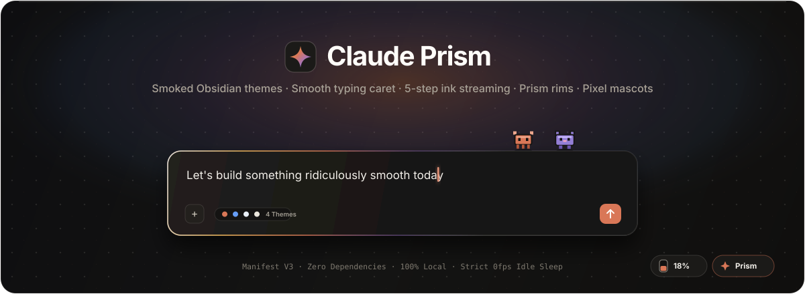

<div align="center">



<br />

**English** · **[Português (BR)](./README.pt-BR.md)**

<p>
  
  
  
  
  
</p>

An optical UI, motion &amp; pixel-mascot extension for **[claude.ai](https://claude.ai)** — inspired by the *Smoked Obsidian* aesthetic.  
**Zero external dependencies · 100% local · No network calls · Strict `0fps` idle sleep.**

</div>

---

## Highlights

| Feature | What it does |
| :--- | :--- |
| **4 Optical Themes + Auto** | **Warm Charcoal** (terracotta), **Obsidian Dark**, **Daylight Crystal**, and **Warm Alabaster** — with adaptive HSL/color token bridging for `claude.ai`, 6 accent tones, and 3 corner-radius styles. |
| **FastDOM Smooth Caret** | Replaces the stiff blinking cursor in Claude's ProseMirror editor with a glowing `2px` caret that glides smoothly as you type — zero forced layout reflow. |
| **Velvet 5-Step Ink Streaming** | Smoothly fades newly streamed Claude tokens over 5 steps using the **CSS Custom Highlight API (`CSS.highlights`)** — zero wrapper `<span>` nodes, zero DOM bloat. |
| **Cursor-Reactive Prism Rim** | Draws a crisp `1.35px` specular refraction hairline on the composer border and settings modal tracking your pointer on a GPU Canvas (auto-shrinks to `0×0` VRAM when idle). |
| **Home Ripple &amp; Horizon Aurora** | Subtle glyph wavefield + aurora glow scoped to the home canvas that ripples with pointer movement and sleeps automatically at `0fps`. |
| **Interactive Pixel Mascots** | **Clawd** (terracotta crab), **Gemini Cat**, **GPT Dragon**, **Deepy Whale**, and **3 Mini Crabs** perched right on top of your prompt box — drag, toss, stack them into a tower, and click for reactions. |
| **Liquid Context Vial** | Compact liquid gauge docked in the bottom-right estimating current conversation context usage, turn count, and code blocks. |
| **Workbench Boosters** | Hover conversation outline rail, `Alt+↑` / `Alt+↓` turn jumping, collapsible long code blocks (`≥ 38` lines), and subtle semantic border cues while streaming. |

---

## Color Palettes

| Palette | Mode | Sidebar | Canvas | Accent |
| :--- | :--- | :--- | :--- | :--- |
| **Warm Charcoal** *(default)* | Dark | `#10100F` | `#141413` | `#D97757` Terracotta |
| **Obsidian Dark** | Dark | `#09090B` | `#0E0E11` | `#669DF6` Cobalt |
| **Daylight Crystal** | Light | `#E8EEF6` | `#F4F7FB` | `#2563EB` Blue |
| **Warm Alabaster** | Light | `#EBE6DC` | `#F6F4EE` | `#C25934` Clay |

---

## Quick Install (Chrome / Edge / Brave)

1. Clone or download this repository:
   ```bash
   git clone https://github.com/touchzada/claudeprism.git
   ```
2. Open your browser's extensions page:
   - Chrome: `chrome://extensions`
   - Edge: `edge://extensions`
   - Brave: `brave://extensions`
3. Enable **Developer mode** (top-right toggle).
4. Click **Load unpacked** and select the `claudeprism` folder.
5. Open (or refresh) **[claude.ai](https://claude.ai)**!

> **Pro tip — Desktop App experience (PWA):**  
> With `claude.ai` open in Chrome or Edge, click the **Install App** icon in the address bar (or `⋮ → Cast, save, and share → Install page as app`). You get a standalone desktop window pinned to your taskbar **running Claude Prism in full** — without patching binaries or fighting Electron fuses.

---

## Shortcuts &amp; Easter Eggs

| Control | Action |
| :--- | :--- |
| **`Alt + Shift + P`** (or click **Prism** pill) | Open the full Claude Prism Control Panel |
| **`Alt + ↑` / `Alt + ↓`** | Jump between your message turns in long chats |
| **Drag &amp; drop a mascot onto another** | Stack mascots into a tower above the composer |
| **Click any mascot** | Pet / trigger reactions (`✨`, `💜`, `🔥`, `💦`) |
| **Stack Gemini Cat + 4 quick clicks** | Unlock the secret **Prismatic Rainbow Coat (`🌈`)** |

Three built-in scene presets live at the top of the settings modal:
- **Full Optical** — all effects &amp; mascots enabled
- **Deep Focus** — crisp themes, smooth caret, ink streaming &amp; context vial, zero distractions
- **Silent Eco** — `0%` ambient glow &amp; animations disabled

---

## Project Structure

```text
claudeprism/
├── manifest.json                 # Chrome / Edge / Brave Manifest V3
├── assets/                       # Vector logo & README hero banner
├── icons/                        # Multi-resolution PNG extension icons
├── scripts/
│   ├── generate-icons.mjs        # Pure-Node zero-dep PNG icon generator
│   └── smoke-test.mjs            # Manifest, syntax, CSS & sandbox smoke tests
└── src/
    ├── core/
    │   ├── config.js             # Settings schema, presets & chrome.storage sync
    │   ├── motion-engine.js      # Damped-spring solver (CSS linear()) & motion tiers
    │   └── theme-bridge.js       # Auto-adaptive HSL/color token bridge for claude.ai
    ├── effects/
    │   ├── smooth-caret.js       # FastDOM smooth typing caret for ProseMirror
    │   ├── ink-stream.js         # 5-step CSS.highlights velvet streaming fade
    │   ├── prism-rim.js          # GPU Canvas cursor-reactive hairline rim
    │   ├── ripple-backdrop.js    # Home glyph ripple & aurora (0fps idle sleep)
    │   └── mascots.js            # 16×13 pixel mascots with physics & tower stacking
    ├── ui/
    │   ├── workbench.js          # Outer composer targeting, vial, outline rail & code fold
    │   └── settings-panel.js     # Smoked Obsidian floating settings modal
    ├── popup/                    # Extension toolbar quick-control popup
    ├── styles/prism.css          # Complete optical stylesheet
    └── content/main.js           # SPA-aware lifecycle bootstrap
```

### Verify locally
```bash
node scripts/smoke-test.mjs
```

---

## Inspiration &amp; Disclaimer

- Visual aesthetic and optical motion principles inspired by **[Obsidian Prism](https://github.com/RMvdesi/obsidian-prism)**.
- **Non-Affiliation:** Claude Prism is an independent open-source project and is not affiliated with, endorsed by, or sponsored by Anthropic PBC.

## License

Released under the **[MIT License](./LICENSE)**.
