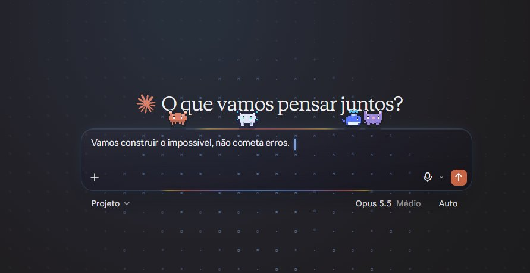

<div align="center">


# Claude Prism

**Interface óptica, física de molas, cursor deslizante e mascotes pixelados para o `claude.ai`**

**[English](./README.md)** · **Português (BR)**

<p>
  
  
  
  
  
</p>



<sub>Captura real rodando no <code>claude.ai</code> — paleta Obsidian Dark, borda prismática reativa ao mouse, cursor deslizante, ondas no fundo e os 4 mascotes pixelados em cima da caixa de prompt.</sub>

</div>

---

## O que tem nela

- **4 Temas Ópticos + Auto:** *Warm Charcoal* (terracota), *Obsidian Dark*, *Daylight Crystal* e *Warm Alabaster*, com 6 cores de destaque e 3 estilos de cantos.
- **Cursor Deslizante (`Smooth Caret`):** substitui o cursor duro do editor do Claude por um tracinho luminoso com deslize fluido ao digitar.
- **Texto Nascendo Suave (`Ink Streaming`):** efeito de tinta em 5 passos nas respostas do Claude usando `CSS.highlights`, sem criar elementos extras no DOM.
- **Borda Prismática no Mouse (`Prism Rim`):** filete luminoso de `1.35px` nas bordas do composer que acompanha o ponteiro e libera memória de vídeo quando ocioso.
- **Ondas e Aurora na Tela Inicial (`Home Ripple`):** matriz sutil de glifos com ondas reativas ao mouse na Home, pausando em `0fps` ao parar.
- **Mascotes Pixelados Interativos:** **Clawd** (caranguejo), **Gemini Cat**, **GPT Dragon**, **Deepy Whale** e **3 mini caranguejos** em cima do prompt — arraste, jogue, empilhe em torre e clique para interagir.
- **Frasco de Contexto + Produtividade:** frasquinho líquido estimando o tamanho do chat, trilha lateral de turnos + `Alt+↑`/`Alt+↓`, recolhimento de blocos de código longos (`≥ 38` linhas) e brilho semântico na borda.

---

## Como instalar (Chrome / Edge / Brave)

1. Baixe ou clone este repositório:
   ```bash
   git clone https://github.com/touchzada/claudeprism.git
   ```
2. Abra a página de extensões do navegador:
   - Chrome: `chrome://extensions`
   - Edge: `edge://extensions`
   - Brave: `brave://extensions`
3. Ative o **Modo do desenvolvedor** no canto superior direito.
4. Clique em **Carregar sem compactação** (*Load unpacked*) e selecione a pasta `claudeprism`.
5. Abra (ou dê `F5`) em **[claude.ai](https://claude.ai)**!

> **Dica (experiência de App Desktop):**  
> Com o `claude.ai` aberto no Chrome ou Edge, clique em **Instalar página como aplicativo (PWA)** na barra de endereços. Ele abre numa janela própria na barra de tarefas **com o Claude Prism inteiro funcionando**.

---

## Atalhos &amp; Segredos

- **`Alt + Shift + P`** (ou clique no botão **Prism** no canto inferior direito): abre o painel completo de configurações.
- **`Alt + ↑` / `Alt + ↓`:** navega rapidamente entre as suas mensagens em conversas longas.
- **Arrastar um mascote sobre o outro:** monta uma torre de mascotes em cima da caixa de prompt.
- **Easter egg secreto (`🌈`):** empilhe o **Gemini Cat** com outro pet e dê **4 cliques rápidos** nele para ativar o modo arco-íris!

---

## Licença

Distribuído sob a **[Licença MIT](./LICENSE)**. Projeto independente, sem afiliação com a Anthropic PBC.
